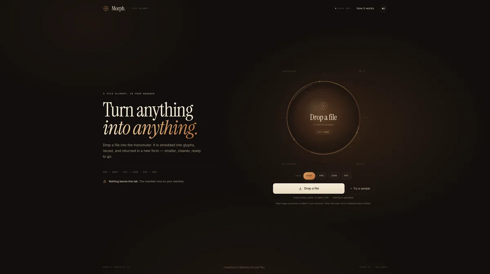

# Morph — File Alchemy

**Live demo:** https://jimmerioles.github.io/morph/

A single-screen prototype of a file converter whose hero **is** the converter. Drop a file onto the transmuter; it is shredded into glyphs, pulled through a copper-and-glass chamber, and rebuilt as another format. The result drops out with a ding.



Static-first, one signature interaction, a physical metaphor, synthesized sound only after a gesture, and a reduced-motion path. No frameworks, no uploads.

## Run it

```bash
npm install
npm run dev
```

Open the URL Vite prints (usually `http://localhost:5173`).

```bash
npm run build    # tsc + vite build
npm run preview  # serve the production build
```

The only network request is Google Fonts (Instrument Serif + Inter). Both have system fallbacks, so the page still works offline.

## What's real

These conversions happen locally in the browser:

- **Images → WebP / PNG** — `createImageBitmap` (with an `` fallback), Canvas2D re-encode, `canvas.toBlob()`. Original pixel dimensions are preserved, up to a 7000 px / 45 MP safety cap.
- **CSV / TSV → JSON** — a quote-aware parser with delimiter detection, duplicate-header handling, and typed values.
- **JSON → JSON** — parse and reindent.

Everything else is deliberately a **demo artifact**:

- PDF target → a valid one-page PDF transmutation record, generated in code.
- JSON target → a metadata JSON record.
- WebP / PNG target from a non-image, or an image the browser cannot decode → a rendered seal image.

Demo results carry a `DEMO` badge and a note explaining that the output is not a true content conversion. Image and CSV results carry `REAL`. The "How it works" dialog repeats this distinction.

## Interactions

- **Drop** a file on the chamber, **click** the chamber/CTA to browse, or **paste** from the clipboard.
- **Try a sample** adapts to the selected target: an original Canvas painting (`orrery-no-7.png`) for image targets, a CSV for JSON, and field notes for PDF.
- Choose a target with the format chips: WebP, PNG, JSON, PDF.
- The file card flies in, shatters into Canvas glyphs, and the ring spins while the result is forged. The result card drops in with a synthesized bell.
- **Download** is a real blob download. **Convert another** resets the chamber.
- The sound toggle mutes the Web Audio synth; the preference persists in `localStorage`.
- Drag-over highlights the ring and changes the prompt to "Release it."

## Motion and accessibility

- The chamber, glyph particles, sparks, and idle dust are Canvas2D. Cards, copy, progress, and result UI are DOM.
- With `prefers-reduced-motion: reduce`, particles are skipped, the canvas is static, and progress fades are shortened; the result still arrives.
- The canvas loop pauses when the tab is hidden or the stage leaves the viewport (`IntersectionObserver` + `visibilitychange`).
- The file picker is a real focusable button; format chips are pressed-state buttons; the download is an anchor with a `download` attribute.
- The hidden file input is not in the tab order. The result panel receives focus after completion so screen-reader and keyboard users land on the download.
- Progress is visual; announcements are limited to start, completion, and errors via an `aria-live` status.
- Layouts checked at 1280 × 800, 768 × 1024, 390 × 844, and 320 × 700.

## Files

```
index.html          markup, headline copy, dialog, SVG sigil
src/main.ts         UI state machine, drag/drop/paste, result UI, focus + motion handling
src/chamber.ts      Canvas2D ring, glyph vortex, sparks, progress arc, visibility pausing
src/convert.ts      real conversions, demo artifacts, generated samples
src/audio.ts        Web Audio shred / forge / ding / error synthesis
src/style.css       warm alchemical identity, responsive layout, reduced-motion rules
```

## Rough edges / next steps

This is a prototype, not a production converter.

- No PDF parsing, video, audio, archive, or HEIC transcoding. Unsupported pairs return a labelled demo artifact.
- Conversion runs on the main thread. A Worker and streaming codecs would be the next step for very large images.
- One file at a time; no batch queue or history. Changing the target after a result requires "Convert another" first.
- The generated PDF is a record, not a rendering of the source. PDF target is intentionally marked demo-only.
- Sample art and demo seals are drawn with Canvas2D; if the display serif is still loading, they use Georgia.
- Possible next steps: format-aware file filters, a conversion history strip, drag-to-share, a service-worker offline shell, and optional WebAssembly codecs for real PDF/video support.
